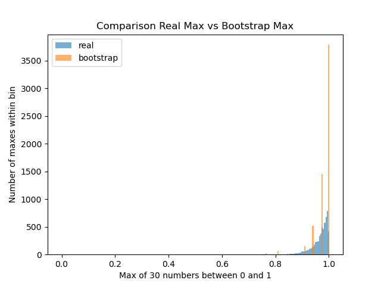

# A.1b — TCL y bootstrap

Simulaciones en Python para comprobar el teorema central del límite y ver dónde falla el bootstrap. Requiere `matplotlib`.

## Cómo ejecutarlo
```
python3 experiment.py       # TCL con dado sesgado [1,1,1,1,1,6]
python3 bootstrap_max.py    # bootstrap del máximo de una uniforme
python3 bootstrap_mean.py    # bootstrap de la media del dado sesgado [1,1,1,1,1,6]
```

## Resultados

### TCL (dado sesgado, semilla 42)
```
n: 1
mean_of_means: 1.8405
standard_deviation: 1.869775320727065
expected_standard_deviation: 1.863389981249825
pct_less_than_1_standard_deviation: 83.19%
pct_less_than_2_standard_deviation: 83.19%
n: 2
mean_of_means: 1.8394
standard_deviation: 1.319718773072506
expected_standard_deviation: 1.3176156917368247
pct_less_than_1_standard_deviation: 69.206%
pct_less_than_2_standard_deviation: 97.218%
n: 5
mean_of_means: 1.833
standard_deviation: 0.8338291191845005
expected_standard_deviation: 0.8333333333333334
pct_less_than_1_standard_deviation: 80.578%
pct_less_than_2_standard_deviation: 96.428%
n: 10
mean_of_means: 1.83415
standard_deviation: 0.5880125657670932
expected_standard_deviation: 0.5892556509887896
pct_less_than_1_standard_deviation: 61.51%
pct_less_than_2_standard_deviation: 98.536%
n: 30
mean_of_means: 1.83429
standard_deviation: 0.3393157760847556
expected_standard_deviation: 0.34020690871988585
pct_less_than_1_standard_deviation: 78.394%
pct_less_than_2_standard_deviation: 97.7%
n: 100
mean_of_means: 1.832425
standard_deviation: 0.18688571206756283
expected_standard_deviation: 0.1863389981249825
pct_less_than_1_standard_deviation: 71.668%
pct_less_than_2_standard_deviation: 95.658%
```

- La media de las medias queda en torno a 1,83 (la media exacta del dado es 11/6 ≈ 1,833) para todos los n, y la desviación estándar medida coincide con σ/√n (en n = 30, 0,339 frente a 0,340). Para n ≥ 2 ronda el 95–98 % (en n = 1 el dado solo toma los valores 1 y 6 y da 83 %). La fracción dentro de 1σ oscila entre el 61 % y el 83 % en vez de acercarse de forma monótona al 68 %, porque las medias de n dados solo pueden tomar valores discretos y algunos caen justo dentro o fuera del borde.

### Bootstrap del máximo (n = 30, 6000 repeticiones, semilla 42)
```
meanRealMaxNums: 0.9678954003776484
meanBootstrapMaxNums: 0.9839162173791627
maxOfSample: 0.9999028930280959
distinctBootstrapMaxNums: 9
numMaxOfSample: 3787
```
- Máximos reales que coinciden con el de la muestra: 0 (por construcción, probabilidad 0 en una uniforme continua).
- El histograma real es continuo: se acumula pegado a 1, con una cola larga hacia la izquierda, y no es simétrico. El del bootstrap es discreto: solo toma unos pocos valores altos, los mayores de la muestra, y deja huecos entre ellos.



### Bootstrap de la media (dado sesgado, n = 30, 10 muestras, semilla 42)
```
true_sd_of_mean: 0.34020690871988585
trial 1, bootstrap_sd: 0.40112686084037597
trial 2, bootstrap_sd: 0.38708825097542016
trial 3, bootstrap_sd: 0.27483136103103817
trial 4, bootstrap_sd: 0.3093254259445907
trial 5, bootstrap_sd: 0.4238811989618475
trial 6, bootstrap_sd: 0.3616446955265197
trial 7, bootstrap_sd: 0.33970335188801215
trial 8, bootstrap_sd: 0.33961261518833735
trial 9, bootstrap_sd: 0.3976124491539748
trial 10, bootstrap_sd: 0.306699027076834
```

- Las 10 desviaciones estándar bootstrap van de 0,27 a 0,42 (media 0,354), frente a 0,340 esperado según las caras del dado. La comparación no es circular porque el valor esperado no sale de la muestra. Con una sola muestra el bootstrap puede quedarse entre 0,07 por debajo y 0,08 por encima del valor esperado; la media de las 10 (0,354) queda cerca de 0,340.

## Qué falló
El bootstrap consiste en tratar una muestra como si fuera la población: se toma una muestra de los datos y, para cada experimento, se saca de ella una remuestra, es decir, un conjunto que solo puede contener valores de esa muestra. Probé el método en dos casos: funciona en uno y falla en el otro. Con la media, que depende de muchos datos a la vez y cambia poco si se mueve uno solo, el bootstrap se ajusta bastante bien a la distribución real, aunque con cierta variación. Con el máximo falla, porque depende de un solo dato, el del extremo. Como la muestra tiene 30 datos, el máximo de cualquier remuestra solo puede ser uno de esos 30 y nunca mayor que el máximo de la muestra. Por eso el histograma real es continuo, con todos los valores posibles, y el del bootstrap tiene unos pocos picos altos y separados, que corresponden a los datos más altos de la muestra (9 valores distintos en 6000 remuestras). En concreto, 3787 de los 6000 máximos bootstrap (63,1 %) coinciden exactamente con el máximo de la muestra, en lugar de repartirse. Una aclaración: el experimento se ejecutó una sola vez, con la semilla 42, y esa muestra tiene un máximo extremadamente cercano a 1 (0,99990). Por eso la media bootstrap (0,984) queda por encima de la real (≈0,968). Eso no dice nada sobre el método: es el resultado de una única muestra atípica.

## Qué queda abierto
- Repetir el bootstrap del máximo con varias muestras originales: la media bootstrap salió de una sola muestra atípica.
- Dado normal y asimetría del dado sesgado, fuera de este alcance.